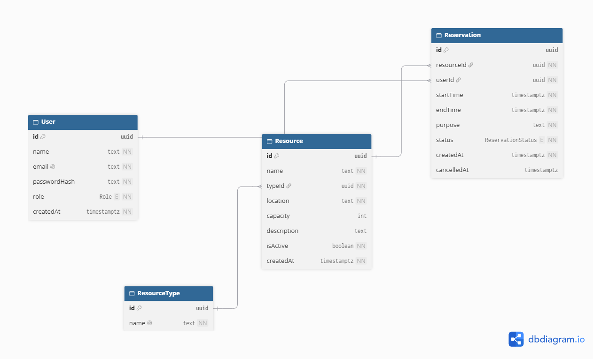
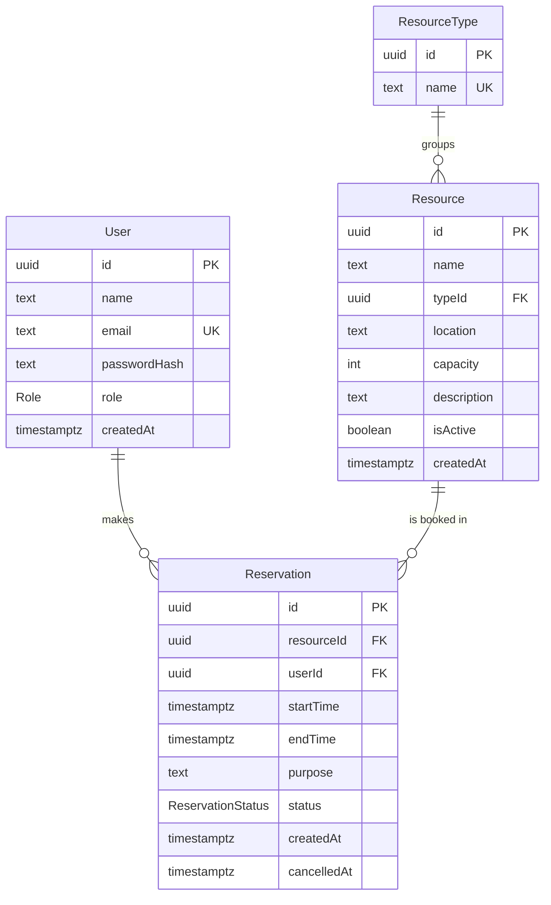

# SlotSync

SlotSync is a resource reservation system for an organisation that shares meeting rooms, equipment and vehicles. It gives everyone one place to see what is free and book it, and it makes double bookings impossible, even when two people click "Book" at the same moment.

Built for the PrimeWave Lab Software Engineering Internship technical assessment.

- **ER diagram:** [view on Google Drive](https://drive.google.com/file/d/1mFugUzjy80rFwpmIhKZeI1LN7UhTeoQF/view?usp=drive_link) · also [shown below](#database-design) (source: [`docs/schema.dbml`](docs/schema.dbml))
- **Demo video:** [watch on Google Drive](https://drive.google.com/file/d/1RksA33jc8mT4OOu1JcABJ9x42fUiQ53O/view?usp=sharing)
- **Repository:** https://github.com/damithch/SlotSync

---

## Contents

1. [Features](#features)
2. [Tech stack](#tech-stack)
3. [Getting started](#getting-started)
4. [Business rules and where they are enforced](#business-rules-and-where-they-are-enforced)
5. [How double bookings are prevented](#how-double-bookings-are-prevented)
6. [Database design](#database-design)
7. [Project structure](#project-structure)
8. [Key design decisions](#key-design-decisions)
9. [Known limitations and future improvements](#known-limitations-and-future-improvements)

## Features

| Role | Can do |
|---|---|
| **Member** | Sign in, browse resources, check a resource's availability for any day, book a slot, view their own upcoming and past bookings, cancel their own upcoming bookings |
| **Admin** | Everything a member can, plus create, edit, deactivate and reactivate resources, and view, filter and cancel **any** booking |

**Pages**

| Page | What it shows |
|---|---|
| `/login` | Email and password sign in |
| `/resources` | All resources (name, type, location, capacity, active/inactive), filterable by type |
| `/resources/[id]` | Resource details, a day picker, that day's bookings and free time, and the booking form |
| `/bookings` | My upcoming bookings (with Cancel) and my past and cancelled bookings |
| `/admin/resources` | Create a resource, and edit, deactivate or activate existing ones |
| `/admin/bookings` | Every booking, filterable by resource and date, with Cancel on upcoming ones |

Every page has loading, empty and error states, shows clear success and error messages, and works at phone width.

**Not built:** the optional extras from the brief (dashboard, search by name, maximum booking length).

## Tech stack

| Part | Choice | Notes |
|---|---|---|
| Framework | Next.js 15 (App Router) | Server Components for reads, Server Actions for writes |
| Language | TypeScript (strict) | |
| Database | PostgreSQL 16 | Runs in Docker for local development |
| ORM | Prisma 6 | Schema, migrations, typed client |
| Validation | Zod | Every form input is validated on the server |
| Auth | Auth.js (NextAuth v5), Credentials provider | Passwords hashed with bcryptjs; user id and role kept in a signed JWT session |
| Styling | Tailwind CSS 4 | |

## Getting started

**You need:** Node.js 20+, Docker Desktop (or your own PostgreSQL 16) and Git.

```bash
# 1. Install packages
npm install

# 2. Create your local env file (Windows PowerShell: copy .env.example .env)
cp .env.example .env

# 3. Put a random secret in AUTH_SECRET inside .env. This prints one:
node -e "console.log(require('crypto').randomBytes(32).toString('base64'))"

# 4. Start PostgreSQL
docker compose up -d

# 5. Create the tables and load demo data
npx prisma migrate dev
npx prisma db seed

# 6. Run the app
npm run dev
```

Open http://localhost:3000 and sign in with a demo account.

### Environment variables

| Variable | Purpose |
|---|---|
| `DATABASE_URL` | PostgreSQL connection. The Docker database listens on host port **5434**, so it doesn't clash with a PostgreSQL already installed on 5432 or 5433. |
| `AUTH_SECRET` | Signs the session cookie. Use your own random value. |
| `APP_TIME_ZONE` | The organisation's time zone, used for days and booking times. Defaults to `Asia/Colombo`. |

### Demo accounts

All demo users have the password `password123`.

| Email | Role |
|---|---|
| admin@slotsync.dev | Admin |
| nimal@slotsync.dev | Member |
| kavya@slotsync.dev | Member |

The seed also creates three resource types (Meeting Room, Equipment, Vehicle), six resources (one of them, the Company Van, inactive) and a few bookings over the next three days. Bookings are placed relative to the day you run the seed, so run `npm run db:seed` again to get fresh upcoming ones.

### Scripts

| Command | What it does |
|---|---|
| `npm run dev` | Start the app in development mode |
| `npm run build` / `npm start` | Production build and server |
| `npm run lint` | ESLint |
| `npm run db:migrate` | Apply database migrations |
| `npm run db:seed` | Reload the demo data |
| `npm run db:reset` | Drop everything, re-run migrations and seed |

### Troubleshooting

- **"Can't reach database server at localhost:5434":** the database container isn't running. Start Docker Desktop, then run `docker compose up -d`.
- **"Authentication failed against database server":** something else is answering on that port. Check `DATABASE_URL` uses port 5434 and matches `docker-compose.yml`.

## Business rules and where they are enforced

All rules are checked on the **server**. Hiding a button in the UI is never the only protection.

| # | Rule | Enforced in |
|---|---|---|
| 1 | `endTime` must be after `startTime` | Zod `reservationSchema`, `createReservation()`, and a database `CHECK` constraint |
| 2 | A booking can't start in the past | `createReservation()` |
| 3 | An inactive resource can't be booked | `createReservation()` (the form is also hidden for inactive resources) |
| 4 | No two CONFIRMED bookings for the same resource may overlap (end times are exclusive) | `createReservation()`, plus a PostgreSQL exclusion constraint ([see below](#how-double-bookings-are-prevented)) |
| 5 | Members cancel only their own bookings; admins can cancel any | `cancelReservation()` |
| 6 | Cancelling sets `status = CANCELLED` and `cancelledAt`; bookings are never deleted | `cancelReservation()` |
| 7 | Resources are deactivated, never deleted | `setResourceActive()`; there is no delete action |
| 8 | Only admins reach `/admin/*` and run admin actions | `src/middleware.ts` for pages, and `requireAdmin()` inside every admin page and server action |

A booking can't be cancelled once it has started. The user on a booking always comes from the session, never from the form, so nobody can book as someone else.

## How double bookings are prevented

Two ranges overlap when `newStart < existingEnd AND newEnd > existingStart`. That allows 9:00–10:00 and 10:00–11:00 next to each other.

`createReservation()` in [`src/lib/reservations.ts`](src/lib/reservations.ts) works in three steps:

1. **App-level check.** It looks for an overlapping CONFIRMED booking and, if there is one, returns a clear message naming the clashing time, e.g. *"Boardroom is already booked for Tuesday, 13 October 2026, 10:00–12:00."*
2. **Database guarantee.** An app check alone has a race condition: two requests can both pass it before either has saved. So PostgreSQL enforces the rule itself, with this constraint ([migration](prisma/migrations/20261012060940_no_overlapping_reservations/migration.sql)):

   ```sql
   ALTER TABLE "Reservation"
     ADD CONSTRAINT "no_overlapping_reservations"
     EXCLUDE USING gist (
       "resourceId" WITH =,
       tstzrange("startTime", "endTime", '[)') WITH &&
     )
     WHERE (status = 'CONFIRMED');
   ```

3. **Friendly race message.** If the insert is rejected by that constraint (PostgreSQL error `23P01`), the user sees *"This slot was just booked by someone else. Please pick another time."* Prisma has no named error for exclusion constraints, so the code checks the error for both `23P01` and the constraint name.

Because the constraint only applies to `CONFIRMED` rows, cancelling a booking frees its slot straight away.

**How this was tested:**
- 10 bookings for the same slot sent at the same moment produced exactly one booking.
- A second test forced the real race: a database transaction held a booking without committing while the app tried the same slot. The app's own check couldn't see the uncommitted row, so it was the database that rejected the insert, and the user got the friendly message.

## Database design



The same design as a Mermaid diagram:



- `Role` is `ADMIN` or `MEMBER`. `ReservationStatus` is `CONFIRMED` or `CANCELLED`.
- `Reservation` is indexed on `(resourceId, startTime)`, which serves the day view and the overlap check, and on `userId`, which serves "My bookings".
- `capacity` is optional because it doesn't apply to everything (a projector has none).

The full design is in [`prisma/schema.prisma`](prisma/schema.prisma) and [`docs/schema.dbml`](docs/schema.dbml). Paste the `.dbml` file into https://dbdiagram.io to view the diagram.

## Project structure

```
src/
  app/
    layout.tsx                       shared layout and navbar
    page.tsx                         redirects to /resources
    loading.tsx, error.tsx, not-found.tsx
    login/                           sign in page and action
    resources/page.tsx               resource list with type filter
    resources/[id]/                  day view, booking form and booking action
    bookings/                        my bookings and the cancel action (shared with admins)
    admin/resources/                 manage resources, edit page and actions
    admin/bookings/page.tsx          all bookings with filters
    api/auth/[...nextauth]/route.ts  Auth.js endpoints
  lib/
    db.ts              single shared PrismaClient
    auth.config.ts     Auth.js settings that don't need the database (used by middleware)
    auth.ts            credentials login, requireAdmin()
    validation.ts      Zod schemas for every form and URL filter
    reservations.ts    booking rules: create, cancel, overlap check, day schedule
    resources.ts       resource rules: create, update, activate/deactivate
    time.ts            organisation time zone helpers
  components/          forms, navbar, cancel button
  middleware.ts        sign in required everywhere; /admin for admins only
  types/next-auth.d.ts adds id and role to the session type
prisma/
  schema.prisma
  migrations/          initial tables, then the overlap and CHECK constraints
  seed.ts              demo users, resources and bookings
docs/
  schema.dbml          ER diagram source for dbdiagram.io
  er-diagram.png       the rendered diagram
```

Pages and server actions stay thin. They check who the user is, validate input with Zod and call a function in `src/lib`, where the business rules live.

## Key design decisions

- **Double bookings are blocked by the database, not only the app.** Simultaneous requests can't both succeed (see above).
- **Soft cancel and soft deactivate.** Nothing is deleted, so history and usage stay accurate. Cancelled bookings free their slot; inactive resources keep their past bookings.
- **Authorisation is checked on the server in every action.** Middleware protects page loads, but a server action can be called directly, so each admin action calls `requireAdmin()` and each cancel checks ownership again.
- **One organisation time zone.** Times are stored as `timestamptz` (exact instants, UTC in the database). Days and wall-clock times are read and shown in the organisation's time zone (`APP_TIME_ZONE`, default `Asia/Colombo`) rather than each viewer's browser zone. A room's 9:00 is the room's 9:00 for everyone, and the server can render pages without knowing the browser's zone. The conversion uses the built-in `Intl` API and handles daylight-saving changes.
- **Split Auth.js config.** Middleware can't use Prisma or bcrypt, so the database-free settings live in `auth.config.ts` (used by middleware) and the credentials check lives in `auth.ts`.
- **Filters live in the URL.** The type, date and admin filters are plain GET forms and links, so they work without JavaScript and can be bookmarked.
- **Untrusted input is validated everywhere.** This includes ids bound to server actions and URL parameters. Invalid filters are ignored instead of crashing the page.

## Known limitations and future improvements

**Limitations**

- There are no automated tests yet. The business rules were checked with scripts against the real database during development (overlap cases, the race, cancel permissions, time zone and daylight-saving conversion), but those scripts aren't part of the repo. Unit tests for `src/lib` would be the first addition.
- Deactivating a resource keeps its existing upcoming bookings. They aren't cancelled, and the admin isn't warned.
- Because pages stream with a loading state, an unknown resource shows the 404 page with HTTP status 200 instead of 404.

**Future improvements**

- Recurring bookings
- Email reminders
- A calendar week view
- Booking approval for some resources
- A usage dashboard and report export
- A maximum booking length
- Search by name
