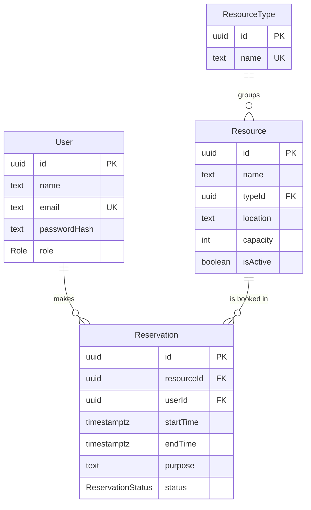

# SlotSync

SlotSync is a resource reservation system for organisations that share rooms, equipment and vehicles. It gives everyone one place to see what is free and book it, and it makes double bookings impossible.

> Work in progress for the PrimeWave Lab internship assessment.

## Tech stack

| Part | Choice |
|---|---|
| Framework | Next.js 15 (App Router) |
| Language | TypeScript |
| Database | PostgreSQL 16 |
| ORM | Prisma |
| Styling | Tailwind CSS |

## Getting started

**You need:** Node.js 20+ and Docker Desktop (or your own PostgreSQL 16).

```bash
# 1. Install packages
npm install

# 2. Create your local env file
cp .env.example .env

# 3. Start PostgreSQL in Docker
docker compose up -d

# 4. Create the tables and load demo data
npx prisma migrate dev
npx prisma db seed

# 5. Run the app
npm run dev
```

Open http://localhost:3000.

### Demo accounts

All demo users have the password `password123`.

| Email | Role |
|---|---|
| admin@slotsync.dev | Admin |
| nimal@slotsync.dev | Member |
| kavya@slotsync.dev | Member |

### Useful scripts

| Command | What it does |
|---|---|
| `npm run db:migrate` | Apply database migrations |
| `npm run db:seed` | Reload the demo data |
| `npm run db:reset` | Drop everything, re-run migrations and seed |

## Database design



The full design is in [`docs/schema.dbml`](docs/schema.dbml) and [`prisma/schema.prisma`](prisma/schema.prisma).

## Key design decisions

**Double bookings are blocked by the database, not only the app.** An app-level check alone has a race condition: two people can click "Book" at the same moment and both pass the check. A PostgreSQL exclusion constraint ([migration](prisma/migrations)) guarantees that no two confirmed reservations for the same resource overlap. End times are exclusive, so 9:00–10:00 and 10:00–11:00 are both allowed.

**Cancelled reservations are kept, not deleted.** A cancelled booking changes its status to `CANCELLED`, which frees the slot (the overlap rule only applies to confirmed bookings) while keeping a history of usage.

**Resources are deactivated, not deleted.** An inactive resource can't be booked, but its past reservations stay intact.

**Times are stored as `timestamptz`.** PostgreSQL stores them in UTC and the app shows them in local time.
